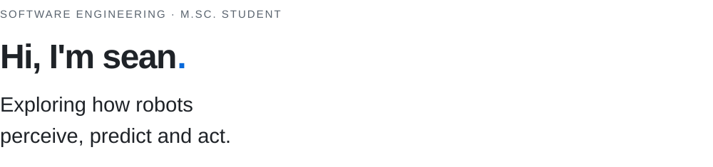

<picture>
  <source media="(prefers-color-scheme: dark)" srcset="assets/intro-dark.svg">
  <source media="(prefers-color-scheme: light)" srcset="assets/intro-light.svg">
  
</picture>

软件工程硕士在读，关注世界模型、规划与机器人学习。  
分享项目实现、实验分析，以及阅读过程中整理的技术资料。

**Focus** &nbsp; World models &nbsp; / &nbsp; Planning &nbsp; / &nbsp; Robot learning

---

Python &nbsp; / &nbsp; PyTorch &nbsp; / &nbsp; ROS 2 &nbsp; / &nbsp; NumPy
